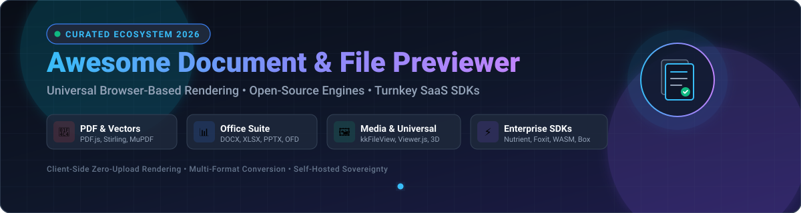
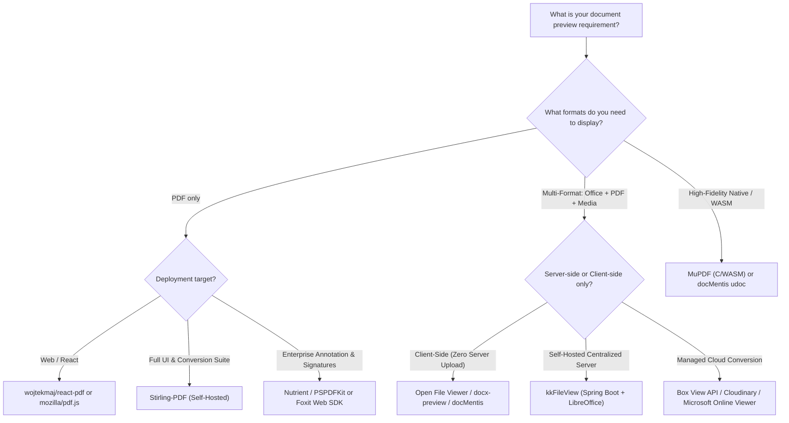

# 📄 Awesome Document & File Previewer 🚀

  

  
  
  
  
  
  

---

## 🌟 Top Document & File Previewer Ecosystem

> 🎯 **A curated directory of browser-based document previewers, multi-format file viewers, and embeddable rendering SDKs.**  
> *Covering self-hosted open-source libraries, client-side WebAssembly engines, and enterprise SaaS solutions.*  
> 🕒 **Last updated: March 2026**

This repository provides an authoritative guide to **Document & File Previewers** for modern web, desktop, and mobile applications. These solutions render PDFs, Microsoft Office documents (Word, Excel, PowerPoint), CAD drawings, EPUBs, images, audio, and video directly within browser contexts—completely eliminating friction from mandatory downloads or local software installations.

Whether you are looking for turnkey commercial SDKs, zero-server-upload client-side engines (WASM/Canvas), or robust self-hosted document servers, this catalog indexes the premier tools available today.

---

## 📑 Table of Contents

- [📊 Sector Overview & Market Dynamics](#-sector-overview--market-dynamics)
- [☁️ SaaS & Hosted Commercial Platforms](#️-saas--hosted-commercial-platforms)
- [💻 Open-Source GitHub Projects](#-open-source-github-projects)
- [🏗️ Architectural Guidelines: How to Choose](#️-architectural-guidelines-how-to-choose)
- [🤝 How to Contribute](#-how-to-contribute)
- [📈 Star History](#-star-history)
- [💖 Support & Sponsorship](#-support--sponsorship)
- [⚖️ Disclaimer & Licensing Guide](#️-disclaimer--licensing-guide)

---

## 📊 Sector Overview & Market Dynamics

The global document management and viewing SDK market is currently valued between **$9.6B to $11.8B** (with the specialized PDF and embedded document viewing developer SDK subsector capturing ~$3.8B), expanding at a compound annual growth rate (**CAGR of ~11–15%**) toward nearly $30B by the 2030s.

The sector demonstrates **moderate-to-high fragmentation** rather than a winner-take-all monopoly:
- **Cloud & Productivity Hyperscalers** (Microsoft, Google, Box) dominate mass file storage and generic public file viewing, but rarely provide customized white-label UI controls or fine-grained in-browser canvas event hooks.
- **Dedicated Commercial SDK Vendors** (Nutrient/PSPDFKit, Apryse, Foxit, Accusoft) lead the high-end enterprise segment with turnkey annotation, digital signature workflows, form-filling, redaction, and strict compliance certifications (HIPAA, SOC 2).
- **Open-Source & Developer-First Libraries** (PDF.js, Stirling-PDF, kkFileView, Viewer.js, docx-preview) form a thriving, decoupled ecosystem providing specialized rendering blocks for teams prioritizing self-hosted control, zero SaaS per-seat costs, and strict data sovereignty.

---

## ☁️ SaaS & Hosted Commercial Platforms

| Product | Company Size (Valuation / Revenue) | Starting Price | Free Tier / Trial Limits | Description |
|:---|:---|:---|:---|:---|
| **[Microsoft Office Online Viewer](https://view.officeapps.live.com/)** | **~$3.88T Market Cap** (~$245B Ann. Revenue) | **Free** (or from **$1.99/mo** for Microsoft 365 Basic / $7.00/user/mo Business) | **Free forever**: Unlimited viewing for publicly accessible Office files via web URL (5 GB cloud storage on free Microsoft accounts) | Free web-based viewer for Office documents via a simple URL parameter. No authentication required for public files. |
| **[Google Drive Viewer](https://drive.google.com/)** | **~$3.50T Market Cap** (~$350B Ann. Revenue) | **Free** (or from **$1.99/mo** for 100 GB via Google One / $7.00/user/mo Workspace) | **Free forever**: Unlimited viewing; includes **15 GB** shared cloud storage per Google account | Built-in viewer for files stored in Google Drive. Supports PDF, Office, images, and video without installation. |
| **[Box View API](https://box.com/)** | **~$6.0B Market Cap** (~$1.18B Ann. Revenue) | From **$15/user/month** (Business plan, min. 3 users; ~$5/user/mo Starter) | **Free developer sandbox**: Non-production testing and app prototyping; or 14-day free business trial | Document conversion and viewing API that transforms files into HTML5 for browser display. |
| **[Cloudinary Document Viewer](https://cloudinary.com/)** | **~$2.0B Valuation** (~$100M+ ARR) | From **$89/month** (billed annually, or $99/mo monthly for Plus Plan) | **Free forever**: **25 credits/month** (~25 GB storage or bandwidth, or 25,000 transformations), max 10 MB image / 100 MB video limit | Media management platform with document preview as a secondary capability. Credit-based pricing can become expensive if used primarily for storage. |
| **[Foxit PDF Web SDK](https://www.foxit.com/)** | **~$840M Market Cap** (~$160M Ann. Revenue) | From **~$3,000/year** (custom annual quote based on platform and scale) | **30-day free trial**: Fully functional developer trial across web and mobile platforms | Browser-based PDF viewer SDK from Foxit. Leverages Foxit's rendering engine for high-fidelity display and annotation. |
| **[PSPDFKit (Nutrient)](https://nutrient.io/)** | **~$300M+ Est. Valuation** (€100M Insight Partners funding; ~$50M+ ARR) | From **~$10,000/year** (~$800–$1,200/mo billed annually for Web SDK; APIs from $75/mo) | **30-day free trial**: Full access to all SDK features across Web, Mobile, and Server | Enterprise document SDK for viewing, annotation, and editing across web, mobile, and desktop. Positioned as the premium commercial option for document-heavy products. |
| **[Accusoft PrizmDoc](https://www.accusoft.com/)** | **~$35M Ann. Revenue** (Acquired by Apryse in 2025) | From **$7,700/year** (PrizmDoc Viewer 1-server, 4-vCPU core license) | **30-day free trial**: Self-hosted evaluation server license key and cloud transaction testing | Document viewing and conversion SDK with server-side rendering. Supports PDF, Office, and CAD formats. |
| **[Filestack Document Viewer](https://www.filestack.com/)** | **~$2M–$5M Ann. Revenue** (Acquired by Idera) | From **$69/month** (Start Plan, or ~$49/mo billed annually) | **Free forever**: **500 uploads/month**, **1 GB bandwidth**, **1 GB storage**, 1,000 transformations, 20 MB max file size | File handling platform with document preview capabilities as part of a broader upload/transform/deliver pipeline. |

---

## 💻 Open-Source GitHub Projects

All open-source document previewers, web viewers, and rendering engines are sorted below by **GitHub Star Count (descending)**:

| Project | Stars | License | Primary Tech Stack | Description |
|:---|:---|:---|:---|:---|
| **[Stirling-PDF](https://github.com/Stirling-Tools/Stirling-PDF)** |  | GPL-3.0 | Java / Spring Boot / Docker | **Robust, self-hosted 100% local PDF manipulation & viewing suite.** Full web UI for viewing, converting, OCR, annotating, splitting, and securing PDFs. Fully offline with zero data leakage. |
| **[PDF.js](https://github.com/mozilla/pdf.js)** |  | Apache-2.0 | JavaScript / HTML5 Canvas | **Mozilla's industry-standard web standards PDF rendering engine.** Renders PDF directly onto HTML5 Canvas. The foundational renderer for Firefox, Chrome extensions, and hundreds of web SDKs worldwide. |
| **[kkFileView](https://github.com/kekingcn/kkFileView)** |  | Apache-2.0 | Java / Spring Boot / LibreOffice | **Universal open-source online document preview service.** Out-of-the-box previewing for DOC, DOCX, XLS, XLSX, PPT, PPTX, PDF, TXT, ZIP, RAR, 7z, MP4, MP3, and CAD drawings in the browser. |
| **[react-pdf](https://github.com/wojtekmaj/react-pdf)** |  | MIT | React / TypeScript / PDF.js | **Most popular modular React wrapper for PDF.js.** Enables effortless inline PDF page rendering in React apps with custom controls, pagination, zooming, virtual scrolling, and text selection layers. |
| **[Viewer.js](https://github.com/fengyuanchen/viewerjs)** |  | MIT | JavaScript (ES6) | **High-performance JavaScript image viewer.** Features modal & inline preview, zoom in/out, rotate, flip, touch gestures, keyboard shortcuts, fullscreen preview, and thumbnail carousels. |
| **[Apache PDFBox](https://github.com/apache/pdfbox)** |  | Apache-2.0 | Java | **Enterprise Java PDF library for rendering, extraction, and generation.** Features PDF-to-image rasterization, form filling, text extraction, and digital signing. Ideal for backend rendering pipelines. |
| **[MuPDF](https://github.com/ArtifexSoftware/mupdf)** |  | AGPL-3.0 / Commercial | C / WASM / Python / Java | **Ultra-fast, lightweight C rendering engine for PDF, XPS, and EPUB.** Exceptionally high fidelity with antialiased graphics, overprint rendering, AcroForms, and WebAssembly compilation bindings. |
| **[docx-preview](https://github.com/VolodymyrBaydalka/docxjs)** |  | Apache-2.0 | TypeScript / DOM | **Client-side Microsoft Word (.docx) renderer.** Parses docx binary structures directly in the browser and translates them into HTML DOM elements without any server conversion. |
| **[Open File Viewer](https://github.com/xushanpei/open-file-viewer)** |  | MIT | Vue / React / Vanilla JS | **Unified client-side multi-format file viewer.** Built-in pluggable support for PDF, DOCX, XLSX, PPTX, OFD, EPUB, XPS, images, audio, video, archives, email, CAD, and 3D files with zero server roundtrips. |
| **[react-doc-viewer](https://github.com/cyntler/react-doc-viewer)** |  | MIT | React / TypeScript | **Extensible React document viewing component.** Includes built-in driver renderers for PDF, CSV, XLSX, DOCX, PNG/JPEG, MP4, and text with a customizable navigation bar and theme support. |
| **[docMentis udoc-viewer](https://github.com/docMentis/docmentis-udoc-viewer)** |  | MIT / WASM Core | Rust / WebAssembly | **WASM-powered universal file viewer for PDF, DOCX, PPTX, and images.** Proprietary Rust-to-WASM rendering engine that executes completely in browser memory without external server dependency. |
| **[Papyrus](https://github.com/solrachix/Papyrus)** |  | MIT | React / React Native / Zustand | **Modular document preview SDK for web and mobile.** Decoupled architecture supporting PDF, EPUB, TXT, CBZ, and CBR with native acceleration on iOS/Android and PDF.js fallback on web. |
| **[Peekin](https://github.com/sumanmichael/peekin)** |  | MIT | Python / Flask | **Lightweight local read-only web file browser.** Renders galleries, video, audio, PDFs, and syntax-highlighted code files directly from local storage with optional network passcode security. |

---

## 🏗️ Architectural Guidelines: How to Choose

1. **For Pure Client-Side Privacy (Zero Uploads):** Choose **[Open File Viewer](https://github.com/xushanpei/open-file-viewer)** or **[docx-preview](https://github.com/VolodymyrBaydalka/docxjs)**. Processing occurs directly inside the user's browser memory via WebAssembly/JavaScript.
2. **For Dedicated PDF Applications:** Choose **[PDF.js](https://github.com/mozilla/pdf.js)** with **[react-pdf](https://github.com/wojtekmaj/react-pdf)** for custom UI control, or deploy **[Stirling-PDF](https://github.com/Stirling-Tools/Stirling-PDF)** for an all-in-one web workstation.
3. **For Enterprise Self-Hosted File Clusters:** Deploy **[kkFileView](https://github.com/kekingcn/kkFileView)** to convert complex Office documents and CAD formats into web-friendly representations on your own internal servers.
4. **For Enterprise Regulated Workflows:** Evaluate **[PSPDFKit (Nutrient)](https://nutrient.io/)** or **[Foxit Web SDK](https://www.foxit.com/)** when bank-grade annotation, redaction, and certified compliance are required.

---

## 🤝 How to Contribute

Contributions are warmly welcomed! Help expand and refine this ecosystem catalog:

1. 🍴 **Fork** the repository.
2. 🌿 Create a new feature branch (`git checkout -b feature/add-new-previewer`).
3. 📝 Add your tool in the corresponding section (SaaS or Open-Source) adhering to the tabular format and sorting criteria.
4. 🔗 Ensure all links and star badges link directly to the correct repository / stargazers page.
5. 🚀 Submit a **Pull Request** with a concise description of the library and its license.

---

## 📈 Star History

---

## 💖 Support & Sponsorship

If you find this curated directory helpful for your development workflow, architecture decisions, or engineering projects, please consider supporting the project:

- ⭐ **Star this repository** on GitHub to increase its visibility for fellow developers.
- 🍴 **Fork and share** the repo across your dev communities, tech blogs, and social networks.
- ☕ **Buy me a coffee & sponsor my work**: You can back future maintenance and open-source contributions directly via the [GitHub Sponsors Dashboard](https://github.com/sponsors/ishandutta2007).

Your support is genuinely appreciated! ❤️

---

## ⚖️ Disclaimer & Licensing Guide

- **Community-Curated**: This list is independently curated for educational and architectural evaluation purposes.
- **Client vs. Server Security**: Client-side rendering keeps proprietary user files completely within browser sandboxes (e.g., Open File Viewer, docx-preview), whereas server-side conversion architectures (kkFileView, Box, PrizmDoc) require strict transport layer encryption (TLS) and ephemeral storage security policies.
- **Licensing Considerations**:
  - **Permissive (Apache-2.0 / MIT)**: *PDF.js, react-pdf, Viewer.js, docx-preview, kkFileView, Open File Viewer* — fully suitable for commercial and proprietary derivative integration without source code disclosure.
  - **Copyleft (GPL-3.0 / AGPL-3.0)**: *Stirling-PDF, MuPDF* — AGPL/GPL requires source distribution if modifications are incorporated into network or distributed applications, or requires purchasing a commercial proprietary license (e.g., from Artifex).
  - **Commercial Quote-Driven**: *Nutrient (PSPDFKit), Accusoft PrizmDoc, Foxit* — require commercial licenses and direct sales contracts for production distribution.
